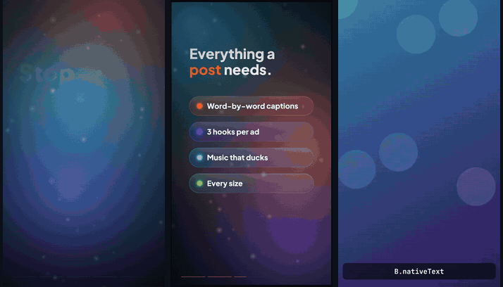

# Motion Factory Kit

**Turn Higgsfield clips into finished UGC ads, or make motion-graphics explainers from scratch, by asking Claude.**

You describe the video. Claude writes it as a small code "scene" and this repo builds a postable MP4:
TikTok-native text, word-by-word captions from the creator's own voice, product cards, reviews,
CTAs, music that ducks under the voice, sound effects, and several hook variants to A/B test.
Exact timing, no timeline editor.



**[See the examples with sound →](https://metacode2023.github.io/motion-factory-kit/)**

## What's in it

- **A raw-footage editor**: drop a client's Drive folder of footage in, get dozens of finished ads out.
  Clips are transcribed, Claude picks the best takes and writes an edit plan per ad, and the kit cuts them
  word-exact (no "um"s, no dead air, punch-in jump cuts, reframed to vertical), adds hooks, captions,
  B-roll, product cards and CTAs, and writes a delivery sheet for the media buyer. See [docs/EDITOR.md](docs/EDITOR.md).
- **Batch ads from a spreadsheet** (`batch-ads.mjs`): one template + one CSV = a folder of ads.
- **High-end visuals** (`kit/fx.js`): animated aurora backgrounds, glass cards, glow, kinetic type, camera
  punches, cinematic transitions, colour grading, film grain and motion blur.

- **One command to a finished video** (`make.mjs`): picture + narration + captions + music + effects,
  loudness-normalized for social. `--variants` renders every hook option.
- **Higgsfield-ready** (`M.video`): drop clips into `assets/higgsfield/` (any size, any frame rate).
  Their audio is mixed in and their speech becomes captions. Or connect the Higgsfield connector and let
  Claude generate the footage too. See [docs/HIGGSFIELD.md](docs/HIGGSFIELD.md).
- **19 building blocks** (`kit/blocks.js`): comment-reply sticker, TikTok text, product card, reviews,
  CTA button, split screen, picture-in-picture, notifications, chat, checklists, stats, charts, phone frame,
  end card. See [docs/BLOCKS.md](docs/BLOCKS.md).
- **Every size**: vertical by default; `--formats 4:5,1:1,16:9` adds feed, square and YouTube versions in the same run.
  Or design natively for another platform with `M.setup({ preset: 'youtube' })` (also `feed`, `square`).
- **Self-checking builds**: every `make.mjs` run writes `out/<name>.report.md` (PASS/FIX for sound,
  captions, footage, the hook at frame 0, text under the app buttons) and `out/<name>.cuts.png` (a still after every cut).
- **Your brand in one file** (`brand.js`): colours, fonts, logo, URL. Every block and caption follows it.
- **A sound library** (`sounds/`): 12 effects and 3 music beds, original and free to use.
- **A design guide** Claude follows (`design/DESIGN.md`): hooks, safe zones, pacing, type, UGC rules.
- **Claude instructions** (`CLAUDE.md` + a `make-video` skill), so Claude Code knows the whole workflow.

## Setup (5 minutes)

You need [Node.js 18+](https://nodejs.org), Python 3 for the checker, and
[Claude Code](https://claude.com/claude-code).

```bash
git clone https://github.com/MetaCode2023/motion-factory-kit.git
cd motion-factory-kit
npm install
node make.mjs scenes/examples/ugc-ad.html    # builds out/ugc-ad.mp4 (with placeholders until you add clips)
```

Optional, but worth it:

```bash
export ELEVENLABS_API_KEY=your_key        # narration + exact captions from speech (PowerShell: $env:ELEVENLABS_API_KEY="your_key")
claude mcp add --transport http higgsfield https://mcp.higgsfield.ai   # let Claude generate Higgsfield clips
```

Then edit `brand.js` with your name, colours and URL.

## Make videos

Run `claude` in this folder and ask. For example:

> I put a talking-head clip in assets/higgsfield/hook.mp4 and a product shot in assets/higgsfield/serum.mp4.
> Make a 15-second UGC ad for Glow Serum, $29. Give me 3 hooks.

> Make a 20-second explainer on why texting back missed calls beats voicemail. Dark, orange accent, narrated.
> Also give me feed and YouTube versions.

> Generate a Higgsfield clip of a creator unboxing our coffee grinder and build an ad around it.

Claude writes `scenes/mine/<name>.html`, builds it, checks the frames, fixes problems, and gives you
`out/<name>.mp4` (or `-v1`, `-v2`, `-v3`). Then just ask for changes: "hook 2 but punchier",
"product card earlier", "lower the music".

## By hand

```bash
node make.mjs scenes/mine/x.html                 # finished MP4 with sound and captions
node make.mjs scenes/mine/x.html --variants      # one MP4 per M.pick option
node make.mjs scenes/mine/x.html --formats 4:5,1:1,16:9   # plus feed, square and YouTube versions
node make.mjs scenes/mine/x.html --fast          # skip the picture score for quick drafts
node make.mjs scenes/mine/x.html --voice-only    # make narration first; prints each line's timing
node render.mjs scenes/mine/x.html --still 6.5   # one frame as a PNG
node footage.mjs index                           # raw footage -> transcripts + thumbnails (footage/INDEX.md)
node footage.mjs build edits/ --variants         # every edit plan -> finished ads + DELIVERY.csv
node batch-ads.mjs scenes/templates/raw-edit.html data/ads.csv   # one ad per spreadsheet row
python score.py out/x.mp4                        # quality check
```

**Preview while editing:** open any scene file in Chrome. It plays with a scrub bar (space = play/pause,
arrows = one frame). Captions show with estimated timing; sound comes from `make.mjs`.

## How a scene looks

```html
<script src="../../brand.js"></script>
<script src="../../kit/motion.js"></script>
<script src="../../kit/blocks.js"></script>
<script>
const HOOK = M.pick(['POV: you found the fix', 'Stop scrolling if your skin hates winter']);
M.setup({ width: 1080, height: 1920, fps: 30, duration: 12, background: '#000',
  captions: true, music: { track: 'pulse', volume: 0.12 }, sfx: [{ at: 0, name: 'pop' }], draw });
const creator = M.video('../../assets/higgsfield/talking-head.mp4', { captions: true });
function draw(ctx, t) {
  creator.draw(ctx, t, 0, 0, 1080, 1920);
  B.nativeText(ctx, t, { at: 0, text: HOOK, y: 320 });
  B.productCard(ctx, t, { at: 6, name: 'Glow Serum', price: '$29', rating: 4.8 });
}
</script>
```

Everything is a function of time `t`, so every frame is exact and every render is identical.

## Folders

```
make.mjs render.mjs batch.mjs voice.mjs score.py   the tools
brand.js                                           your colours, fonts, logo
kit/motion.js  kit/blocks.js                       animation helpers and blocks
design/DESIGN.md                                   the style rules Claude follows
docs/                                              Higgsfield guide, block reference, the gallery page
scenes/examples/                                   ugc-ad, showcase, blocks-gallery, and more
scenes/mine/                                       your scenes
assets/higgsfield/                                 your clips
sounds/                                            effects and music beds
fonts/                                             bundled open-source fonts
out/                                               renders (git-ignored)
```

## Checks on every change

`.github/workflows/check.yml` re-renders the examples and runs the tests on every push, and attaches
the videos and reports to the run. Fork it and your changes get the same safety net.

## License

Code and sounds: MIT. Fonts: SIL Open Font License (see `fonts/LICENSE.txt`).
