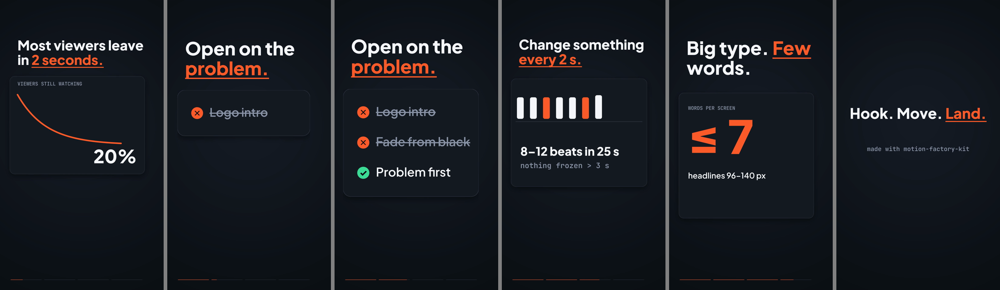

# Motion Factory Kit

**Have Claude make motion-graphics videos for you, as code.**

You describe a video. Claude writes it as a small HTML "scene" that draws each frame, and this repo
renders it to a crisp MP4: exact timing, no screen recording, no After Effects. Built for vertical
explainers (TikTok, Reels, Shorts), works for any size.



## What you get

- **A renderer** (`render.mjs`): scene → MP4, plus an optional GIF and a 6-frame contact sheet for checking.
  A 25-second 1080×1920 video renders in about 15–25 seconds on a laptop. No browser needed.
- **An animation kit** (`kit/motion.js`): big auto-fitting headlines, push cuts, cards that build row by
  row, progress bars, typewriter text, counting numbers, photo backgrounds, easing.
- **A design guide** (`design/DESIGN.md`): the rules that make short-form video work (hook in frame 0,
  safe zones around the TikTok/Reels buttons, pacing, type sizes, motion). Claude follows it.
- **A quality checker** (`score.py`): flags frozen stretches, slow openings, half-empty frames and
  text hidden under the app UI.
- **Instructions for Claude** (`CLAUDE.md` + a `make-video` skill) so Claude Code knows the whole workflow.
- **Examples** in `scenes/examples/`, plus optional ElevenLabs narration (`voice.mjs`).

## Setup (5 minutes)

You need [Node.js 18+](https://nodejs.org) and, for the checker, Python 3. Then:

```bash
git clone https://github.com/MetaCode2023/motion-factory-kit.git
cd motion-factory-kit
npm install
npm run demo          # renders out/loan-calculator.mp4 — open it to check everything works
```

## Use it with Claude Code (recommended)

Install [Claude Code](https://claude.com/claude-code), open a terminal in this folder, run `claude`, and ask:

> Make a 20-second vertical video explaining why our 24/7 booking line beats voicemail.
> Dark background, orange accent.

Claude reads `CLAUDE.md` and the design guide, writes `scenes/mine/<name>.html`, renders it, looks
at the frames itself, fixes problems, and gives you `out/<name>.mp4`. Then just ask for changes:
"make the hook bigger", "slow down beat 3", "add my logo from assets/logo.png at the end".

Other good asks:
- "Turn this blog post into a 25-second explainer: <paste>"
- "Make 3 variations of the hook and render each"
- "Use the photo in assets/shop.jpg as the opening background"

Using Claude in the app instead? Paste in `CLAUDE.md`, `design/DESIGN.md` and
`scenes/examples/showcase.html`, ask for a scene, save it to `scenes/mine/`, and render it yourself.

## Rendering by hand

```bash
node render.mjs scenes/examples/showcase.html --sheet     # MP4 + contact sheet in out/
node render.mjs scenes/mine/x.html --gif                  # also a GIF
node render.mjs scenes/mine/x.html --still 6.5            # one PNG at t = 6.5 s
node render.mjs scenes/mine/x.html --from 8 --to 12       # just one section, while iterating
node render.mjs scenes/mine/x.html --audio voice.mp3      # add narration or music
node batch.mjs scenes/mine --sheet                        # render a whole folder
python score.py out/x.mp4                                 # quality check
```

**Preview while editing:** open any scene file in Chrome. It plays with a scrub bar
(space = play/pause, arrow keys = one frame).

## Narration (optional)

```bash
export ELEVENLABS_API_KEY=your_key          # Windows PowerShell: $env:ELEVENLABS_API_KEY="your_key"
node voice.mjs "Most viewers leave in two seconds." --out out/voice.mp3
node render.mjs scenes/mine/x.html --audio out/voice.mp3
```

Pass `--voice <voice_id>` to use your own ElevenLabs voice. Keep keys in your environment, never in a scene file.

## How a scene works

```html
<script src="../../kit/motion.js"></script>
<script>
M.fonts(['800 100px "Plus Jakarta Sans"']);
M.setup({
  width: 1080, height: 1920, fps: 30, duration: 6, background: '#0B0D12',
  draw(ctx, t) {   // paint the frame at t seconds
    M.headline(ctx, t, 'Hello, motion.', 120, 260, { family: '"Plus Jakarta Sans"', accent: 'motion.' });
  },
});
</script>
```

Everything is a function of `t`, so every frame is exact and renders the same every time.
The default engine runs the scene in Node with [skia-canvas](https://skia-canvas.org); HTML/CSS layout
is ignored and only fonts in `fonts/` are available. `--engine chrome` renders in a real Chrome you've
started with `--remote-debugging-port=9222` instead.

## Folders

```
render.mjs  batch.mjs  voice.mjs  score.py   the tools
kit/motion.js                                the animation helpers every scene loads
engines/                                     skia (default) and chrome renderers
design/DESIGN.md                             the house style Claude follows
scenes/examples/                             patterns to copy
scenes/mine/                                 your scenes go here
assets/                                      your photos and clips
fonts/                                       bundled open-source fonts (SIL OFL)
out/                                         renders (git-ignored)
```

## License

Code: MIT. Fonts: SIL Open Font License (see `fonts/LICENSE.txt`).
