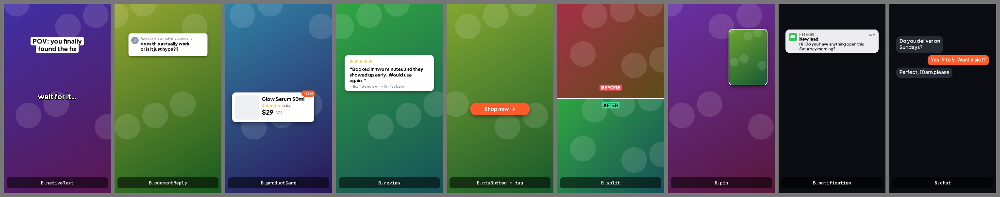
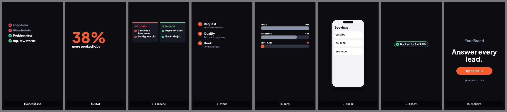

# Blocks

Ready-made pieces in `kit/blocks.js`, styled from `brand.js`. Load them in a scene:

```html
<script src="../../brand.js"></script>
<script src="../../kit/motion.js"></script>
<script src="../../kit/blocks.js"></script>
```

Every block is `B.name(ctx, t, { at, ...options })`, called from your `draw(ctx, t)`. `at` is when
it enters, `until` (where offered) when it leaves. Most return `{ bottom }` so you can stack the next
thing under it. Sizes assume a 1080 × 1920 frame. Anything with `at: 0` is fully visible on frame 0.

See them all moving: `node render.mjs scenes/examples/blocks-gallery.html`




## UGC / TikTok-native

| Block | Key options |
|---|---|
| `B.nativeText` | `text, x (centre), y, size=64, style: 'box' \| 'dark' \| 'blue' \| 'outline' \| 'shadow' \| 'plain', bg, color, until` — `dark`/`blue` are Reels title pills, `shadow` is the meme-caption look |
| `B.commentReply` | `user, text, x, y, w` — the "Reply to @user's comment" sticker |
| `B.productCard` | `image (M.image), name, price, oldPrice, rating, reviews, badge, y` — slides up |
| `B.review` | `name, text, rating, verified, light` |
| `B.stars` | `x, y, size, rating` (fractional ok) |
| `B.ctaButton` | `text, x (centre), y, color, tapAt` — pops, pulses, optional tap |
| `B.tap` | `x, y` — finger tap ripple |
| `B.split` | `left, right` (clips or draw functions), `labels: ['BEFORE','AFTER']`, `mode: 'vertical' \| 'horizontal'` |
| `B.pip` | `layer` (clip or draw function), `x, y, w, h, radius` — picture-in-picture |
| `B.sticker` | `emoji, at, x, y, size, rotate` — emoji sticker that pops and wobbles |
| `B.emojiBurst` | `emoji: [...], at, x, y, count, height, spread` — reactions floating up |
| `B.postCard` | `name, handle, text, image, likes, comments, reposts` — a social post (generic, no logos) |
| `B.browser` | `url, image or drawPage(ctx, x, y, w, h), scroll` — a browser window |

## Street interviews

| Block | Key options |
|---|---|
| `B.questionCard` | `text, label='We asked', y, until, light` — the host's question, pinned while people answer. Returns `{ bottom }` |
| `B.lowerThird` | `name, detail, y, until` — accent bar + name. Only names/details people actually gave |
| `B.counter` | `n, total, mode: 'chip' \| 'big', label, x, y` — "7/50" badge, or the total counting up for an opener |
| `B.tally` | `title, options: [{ label, value }], y` — poll result bar. Real counts only |

## Creator formats

| Block | Key options |
|---|---|
| `B.photoPanel` | `items: [{ at, image \| video \| draw }], x, y, w, h, until` — framed picture over the top that swaps on each item of a spoken list |
| `B.memeCard` | `text, y, size` — white band with black text across the top; returns `{ bottom }` to draw the clip under it |

## Explainer UI

| Block | Key options |
|---|---|
| `B.notification` | `app, title, body, time, y, light` — drops in from the top |
| `B.chat` | `messages: [{ at, text, me }]`, `y, size, light` — typing dots before replies |
| `B.checklist` | `items: [{ at, text, ok }]` — checks pop, crosses strike through |
| `B.stat` | `value, prefix, suffix, decimals, label, size, align` — counts up |
| `B.compare` | `left: { title, items }, right: { title, items }` — before/after columns |
| `B.steps` | `steps: [{ at, title, sub }]` — numbered, connector fills |
| `B.bars` | `data: [{ label, value }], highlight, format` — grows in |
| `B.phone` | `drawScreen(ctx, x, y, w, h)` or `screen: clip`, `tilt` — phone frame |
| `B.toast` | `text, kind: 'good' \| 'bad' \| 'info', until` |
| `B.endCard` | `takeaway, cta, url` — logo/name, headline, button, URL |

Helpers: `B.brand` (merged brand settings), `B.balanced(ctx, text, width, font)` (even line breaks).

## Adding your own block

Copy one from `kit/blocks.js`, keep the `(ctx, t, { at, ... })` shape, read colours from `B.brand`,
and add it to `scenes/examples/blocks-gallery.html` so you can see it.
