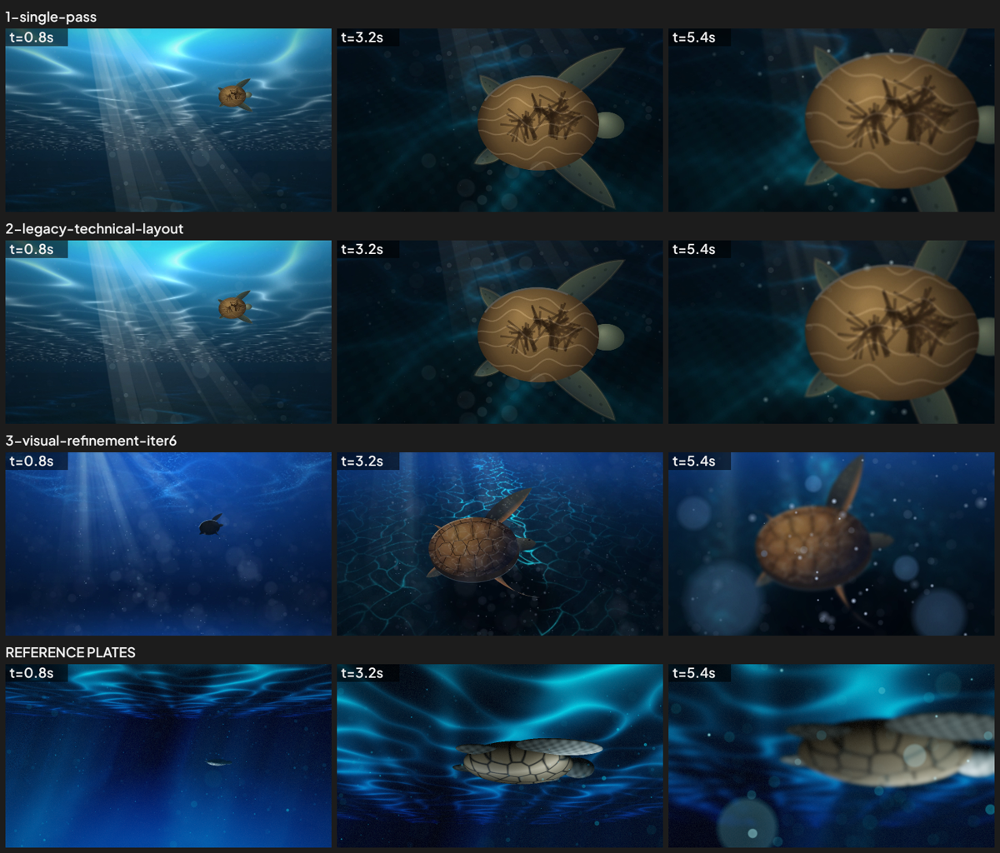

# Three-path comparison: underwater-documentary

Measured against the contract's lookdev plates at each keyframe. "Distance" is the mean capped gap used for early stopping, not a quality score; "hard blocks" are measured gaps beyond 2x tolerance (or generic-default tripwires) per criterion. Visual verdicts come from the isolated critiques in each run.

| Path | Video sha256 | Distance | Open measured deltas | composition blocks | lighting blocks | materials blocks | spatial blocks | color blocks | narrative blocks | originality blocks |
|---|---|---|---|---|---|---|---|---|---|---|
| 1-single-pass | `d8277dbb6de9` | 0.435 | 35 | 1 | 7 | 1 | 1 | 11 | 0 | 0 |
| 2-legacy-technical-layout | `2f9145a01aae` | 0.435 | 35 | 1 | 7 | 1 | 1 | 11 | 0 | 0 |
| 3-visual-refinement-iter6 | `faf97315dad1` | 0.202 | 14 | 0 | 3 | 2 | 0 | 0 | 0 | 0 |

## 1-single-pass

- t=0.8s vs plate-1-establishing: distance 0.476; failing lumaMean (2.745x), contrast (4.565x), falloff (5.467x), hist (4.709x), bMean (2.892x), aMean (3.254x), chroma (2.28x), hue (2.686x), structure (3.449x), detail (1.006x), bands (3.409x)
- t=3.2s vs plate-2-hero: distance 0.415; failing lumaMean (1.157x), contrast (2.026x), falloff (3.512x), hist (2.023x), bMean (3.358x), chroma (1.853x), hue (2.264x), structure (1.939x), detail (1.803x), bands (1.056x), bMean (3.265x), chroma (2.168x)
- t=5.4s vs plate-3-macro: distance 0.415; failing contrast (1.795x), falloff (1.65x), hist (1.597x), bMean (3.596x), chroma (1.237x), hue (9.607x), structure (1.982x), thirdsDistance (1.187x), detail (1.673x), speckleDensity (2.558x), bMean (4.278x), chroma (1.68x)

## 2-legacy-technical-layout

- t=0.8s vs plate-1-establishing: distance 0.476; failing lumaMean (2.745x), contrast (4.565x), falloff (5.467x), hist (4.709x), bMean (2.892x), aMean (3.254x), chroma (2.28x), hue (2.686x), structure (3.449x), detail (1.006x), bands (3.409x)
- t=3.2s vs plate-2-hero: distance 0.415; failing lumaMean (1.157x), contrast (2.026x), falloff (3.512x), hist (2.023x), bMean (3.358x), chroma (1.853x), hue (2.264x), structure (1.939x), detail (1.803x), bands (1.056x), bMean (3.265x), chroma (2.168x)
- t=5.4s vs plate-3-macro: distance 0.415; failing contrast (1.795x), falloff (1.65x), hist (1.597x), bMean (3.596x), chroma (1.237x), hue (9.607x), structure (1.982x), thirdsDistance (1.187x), detail (1.673x), speckleDensity (2.558x), bMean (4.278x), chroma (1.68x)

## 3-visual-refinement-iter6

- t=0.8s vs plate-1-establishing: distance 0.228; failing falloff (3.038x), hist (1.223x), structure (1.949x), detail (2.116x), speckleDensity (1.253x), bands (1.824x)
- t=3.2s vs plate-2-hero: distance 0.165; failing contrast (2.364x), hist (1.014x), structure (1.615x), speckleDensity (1.26x)
- t=5.4s vs plate-3-macro: distance 0.214; failing contrast (2.541x), hist (1.466x), structure (1.765x), detail (2.03x)

Videos (not in git; sha256 above): out/refine/demo/path1-single-pass.mp4, path2-legacy.mp4, path3-refined-iter6.mp4. Path 3 is the latest unapproved iteration: the run escalated budget-exhausted, so `refine final` (the approved deliverable) is correctly refused.
